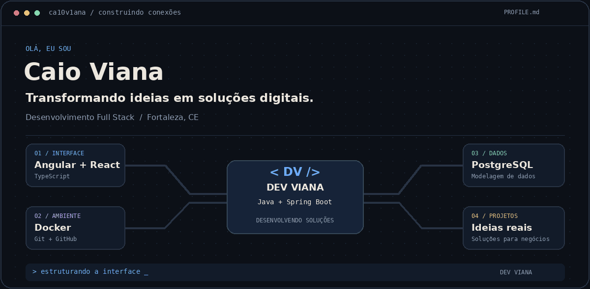

<h1 align="center">Olá, eu sou Caio Viana 👋</h1>

  

  <strong>Interfaces com propósito. Sistemas que resolvem problemas reais.</strong>

  <a href="https://www.linkedin.com/in/caio-viana-898811312/">LinkedIn</a>
  &nbsp;·&nbsp;
  <a href="https://www.instagram.com/caioviana.dev/">Instagram profissional</a>
  &nbsp;·&nbsp;
  <a href="mailto:caiodeoliveira076@gmail.com">Vamos conversar</a>

  

---

### Um pouco sobre mim

Sou **Caio de Oliveira Viana**, de Fortaleza, Ceará. Estudo **Engenharia de Software na UniAteneu** e construo sites e sistemas voltados às necessidades de pessoas e pequenos negócios.

Meu foco é evoluir no desenvolvimento **Full Stack**, conectando interfaces em **Angular e React** a APIs com **Java e Spring Boot**, com atenção à experiência do usuário, organização do código e banco de dados.

- 💻 Transformo ideias em sites, catálogos e sistemas de gestão.
- 📚 Aprofundo meus estudos em Java, Spring Boot, PostgreSQL e Docker.
- 🌱 Também exploro Kotlin e boas práticas de desenvolvimento.
- 🎯 Gosto de acompanhar o projeto da primeira ideia até a aplicação funcionando.

### Minha caixa de ferramentas

  
  
  
  
  

  
  
  
  
  

### Ideias que viraram projetos

| Projeto | O que estou construindo |
| :--- | :--- |
| **JS BOY** | Sistema para uma empresa familiar de entregas, com pedidos, múltiplas paradas e comunicação entre clientes, entregadores e proprietário. |
| **[Sonho de Pudim](https://github.com/CA10V1ANA/sonho-de-pudim)** | Site vitrine para apresentar produtos e a identidade de um negócio de doces. |
| **Dulce di Naty** | Vitrine digital para apresentar brownies e informações de revenda. |
| **BRO’S BURGUER** | Cardápio digital e proposta de PDV com foco no uso pelo celular. |

  <a href="https://github.com/CA10V1ANA?tab=repositories">Explorar meus repositórios →</a>

### Como eu gosto de construir

**Entender o problema → desenhar a experiência → desenvolver → testar → evoluir.**

Cada projeto é uma oportunidade de aprender e entregar algo útil. Busco unir uma interface clara, regras de negócio bem definidas e uma base que permita continuar evoluindo o sistema.

---

  <strong>Tem uma ideia para tirar do papel?</strong> 
  <a href="mailto:caiodeoliveira076@gmail.com">Vamos construir a próxima conexão.</a>

Caio Viana · DEV VIANA · Desenvolvendo soluções

